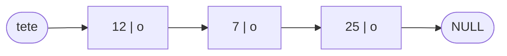
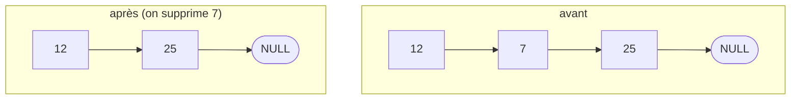

## L'idée

Un tableau, c'est une rangée de cases **contiguës**, de taille fixe. Pour insérer un élément au début, il faut décaler tous les autres ; pour en ajouter quand le tableau est plein, il faut tout recopier ailleurs.

Une **liste chaînée** est une suite de **maillons** dispersés en mémoire. Chaque maillon contient une **valeur** et l'**adresse du maillon suivant**. C'est comme une chasse au trésor : chaque indice indique où trouver le suivant. Pour ajouter un maillon, il suffit de modifier une ou deux adresses.



*Figure : tete désigne le premier maillon ; chaque maillon contient une valeur et l'adresse du suivant (o) ; le dernier pointe vers NULL.*

## Le maillon

```c
typedef struct Noeud {
    int valeur;
    struct Noeud *suivant;
} Noeud;
```

La structure contient un pointeur vers une structure **du même type** : on dit qu'elle est **autoréférente**. On doit donc lui donner un nom (`struct Noeud`) avant le `typedef`.

La liste elle-même n'est qu'un pointeur sur le premier maillon : `Noeud *tete = NULL;`. Une liste vide, c'est une tête qui vaut `NULL`.

## Créer un maillon

```c
Noeud *creer_noeud(int valeur) {
    Noeud *n = malloc(sizeof(Noeud));
    if (n == NULL) {
        return NULL;
    }
    n->valeur = valeur;
    n->suivant = NULL;
    return n;
}
```

## Parcourir une liste

```c
void afficher(const Noeud *tete) {
    const Noeud *courant = tete;
    while (courant != NULL) {
        printf("%d -> ", courant->valeur);
        courant = courant->suivant;
    }
    printf("NULL\n");
}
```

Le schéma de parcours est toujours le même : un pointeur `courant` part de la tête et suit les flèches `suivant` jusqu'à `NULL`. Compter les éléments, faire une somme, chercher une valeur : tout se fait sur ce modèle.

## Insérer en tête

```c
int inserer_tete(Noeud **tete, int valeur) {
    Noeud *n = creer_noeud(valeur);
    if (n == NULL) {
        return 0;
    }
    n->suivant = *tete;   /* le nouveau pointe sur l'ancienne tête */
    *tete = n;            /* il devient la tête */
    return 1;
}
```

On appelle : `inserer_tete(&tete, 12);`. La fonction reçoit l'**adresse du pointeur de tête** (`Noeud **`), car elle doit le modifier. C'est le passage par adresse appliqué à un pointeur.

L'ordre des deux lignes est essentiel : si l'on écrivait d'abord `*tete = n`, on perdrait l'adresse de l'ancienne liste.

## Insérer en queue

```c
int inserer_queue(Noeud **tete, int valeur) {
    Noeud *n = creer_noeud(valeur);
    if (n == NULL) {
        return 0;
    }
    if (*tete == NULL) {          /* liste vide */
        *tete = n;
        return 1;
    }
    Noeud *courant = *tete;
    while (courant->suivant != NULL) {
        courant = courant->suivant;   /* on va jusqu'au dernier */
    }
    courant->suivant = n;
    return 1;
}
```

Il faut parcourir toute la liste pour trouver le dernier maillon. Pour l'éviter, on peut garder aussi un pointeur sur la **queue**.

## Supprimer un élément

Pour supprimer le premier maillon qui contient une valeur, on doit raccorder son **précédent** à son **suivant** :

```c
int supprimer(Noeud **tete, int valeur) {
    Noeud *courant = *tete, *precedent = NULL;
    while (courant != NULL && courant->valeur != valeur) {
        precedent = courant;
        courant = courant->suivant;
    }
    if (courant == NULL) {
        return 0;                          /* valeur absente */
    }
    if (precedent == NULL) {
        *tete = courant->suivant;          /* on supprime la tête */
    } else {
        precedent->suivant = courant->suivant;
    }
    free(courant);
    return 1;
}
```



*Figure : avant et après la suppression de 7 : le maillon 12 pointe directement vers 25.*

Deux cas à ne jamais oublier : la liste **vide**, et la suppression de la **tête**.

## Libérer toute la liste

```c
void liberer(Noeud **tete) {
    Noeud *courant = *tete;
    while (courant != NULL) {
        Noeud *suivant = courant->suivant;   /* on garde l'adresse AVANT free */
        free(courant);
        courant = suivant;
    }
    *tete = NULL;
}
```

Si l'on faisait `free(courant)` puis `courant = courant->suivant`, on lirait une zone déjà libérée.

## Tableau ou liste chaînée ?

| Opération | Tableau | Liste chaînée |
|---|---|---|
| Accès au i-ème élément | O(1) : immédiat | O(n) : il faut parcourir |
| Insertion ou suppression en tête | O(n) : décalage | O(1) |
| Insertion en queue | O(1) s'il reste de la place | O(n), ou O(1) avec un pointeur de queue |
| Recherche d'une valeur | O(n), ou O(log n) si trié | O(n) |
| Mémoire | compacte | un pointeur en plus par élément |
| Taille | fixe (ou réallocation) | grandit à la demande |

La notation **O(n)** indique que le temps grandit proportionnellement au nombre d'éléments ; **O(1)** que le temps est constant, quelle que soit la taille.

Variantes : la liste **doublement chaînée** (chaque maillon connaît aussi son précédent, ce qui permet de parcourir dans les deux sens) et la liste **circulaire** (le dernier pointe sur le premier).

## Démonstration

```c
int main(void) {
    Noeud *tete = NULL;
    inserer_tete(&tete, 7);
    inserer_tete(&tete, 12);
    inserer_queue(&tete, 25);
    afficher(tete);              /* 12 -> 7 -> 25 -> NULL */
    supprimer(&tete, 7);
    afficher(tete);              /* 12 -> 25 -> NULL */
    liberer(&tete);
    afficher(tete);              /* NULL */
    return 0;
}
```

On dessine la mémoire à chaque étape au tableau, avec les flèches, puis on lance `valgrind` pour vérifier qu'aucune mémoire n'est perdue.

## Exercice guidé

1. Écris `int longueur(const Noeud *tete)`.
2. Écris `int somme(const Noeud *tete)`.
3. Écris `int contient(const Noeud *tete, int valeur)`, qui renvoie 1 si la valeur est présente.

## Exercice autonome

1. Écris `int inserer_trie(Noeud **tete, int valeur)`, qui insère la valeur à sa place dans une liste triée par ordre croissant.
2. Écris `void inverser(Noeud **tete)`, qui inverse la liste **sans créer de nouveau maillon**.
3. Adapte la liste pour stocker des étudiants (nom et moyenne) au lieu d'entiers.

## Correction

Exercice guidé :

```c
int longueur(const Noeud *tete) {
    int n = 0;
    for (const Noeud *c = tete; c != NULL; c = c->suivant) {
        n++;
    }
    return n;
}
```

`somme` et `contient` suivent exactement le même modèle de parcours.

Exercice autonome :

```c
int inserer_trie(Noeud **tete, int valeur) {
    Noeud *n = creer_noeud(valeur);
    if (n == NULL) {
        return 0;
    }
    if (*tete == NULL || valeur <= (*tete)->valeur) {
        n->suivant = *tete;
        *tete = n;
        return 1;
    }
    Noeud *c = *tete;
    while (c->suivant != NULL && c->suivant->valeur < valeur) {
        c = c->suivant;
    }
    n->suivant = c->suivant;
    c->suivant = n;
    return 1;
}

void inverser(Noeud **tete) {
    Noeud *precedent = NULL, *courant = *tete;
    while (courant != NULL) {
        Noeud *suivant = courant->suivant;
        courant->suivant = precedent;   /* on retourne la flèche */
        precedent = courant;
        courant = suivant;
    }
    *tete = precedent;
}
```

Pour `inverser`, on avance avec trois pointeurs et on retourne chaque flèche une à une. Dessine-le sur papier avec une liste de 3 éléments : c'est un exercice classique d'entretien technique.

## Pour aller plus loin

- Visualise les listes chaînées sur visualgo.net (rubrique *Linked List*).
- Les listes chaînées servent à construire les piles, les files, les tables de hachage et les graphes.
- Cours suivant : « Les piles et les files ».
