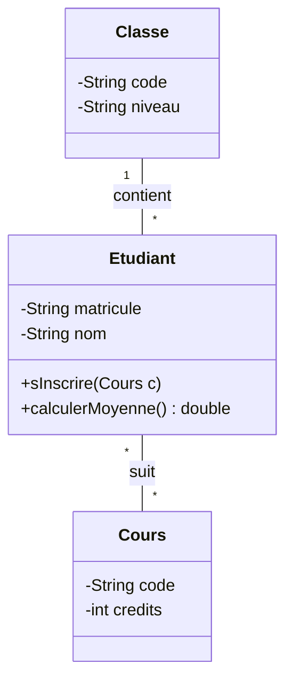
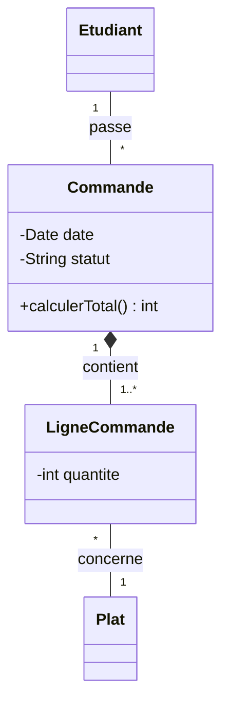

## L'idée

Avant de construire une maison, l'architecte dessine des **plans** : vue de dessus, façade, plomberie. Chaque plan montre un aspect différent de la même maison.

**UML** (*Unified Modeling Language*) est le langage de plans du logiciel. Normalisé par l'OMG en 1997, il est utilisé dans le monde entier pour **comprendre un besoin**, **concevoir** une application et **communiquer** entre développeurs, clients et chefs de projet. Merise modélise surtout les **données** ; UML modélise aussi les **utilisateurs**, les **comportements** et les **échanges**, et il est adapté à la programmation orientée objet que tu verras en L2.

## Les principaux diagrammes

UML 2.5 compte 14 diagrammes. Trois suffisent pour commencer :

| Diagramme | Question | Moment |
|---|---|---|
| **Cas d'utilisation** | Qui utilise le système, et pour faire quoi ? | Analyse du besoin |
| **Classes** | Quels objets, avec quelles données et quels comportements ? | Conception |
| **Séquence** | Dans quel ordre les éléments échangent-ils pour un scénario ? | Conception détaillée |

D'autres sont courants : le diagramme d'**activité** (un organigramme amélioré), d'**états-transitions** (les états d'une commande : créée, payée, livrée), et de **déploiement** (les serveurs).

## Le diagramme de cas d'utilisation

Il décrit le système **vu de l'extérieur** :

- les **acteurs** (petit bonhomme) : des **rôles** qui interagissent avec le système, humains ou non ;
- les **cas d'utilisation** (ellipses) : les services rendus, nommés par un **verbe à l'infinitif** (« Réserver une salle ») ;
- le **cadre** du système (rectangle) ;
- les relations : un trait entre acteur et cas ; **include** (le cas utilise toujours un autre cas) ; **extend** (un comportement optionnel s'ajoute) ; la **généralisation** entre acteurs (un Administrateur est un Utilisateur avec plus de droits).

Exemple pour une plateforme de cours :

```text
                +-------------------- Plateforme de cours -------------------+
                |                                                            |
 [Apprenant] ---+--- (S'inscrire)                                            |
       |        |                                                            |
       +--------+--- (Suivre un cours) ----include----> (S'authentifier)     |
       |        |                                                            |
       +--------+--- (Passer un quiz)                                        |
                |                                                            |
 [Admin] -------+--- (Publier un cours) ---include----> (S'authentifier)     |
                |                                                            |
                +------------------------------------------------------------+
```

Chaque cas d'utilisation est ensuite détaillé dans une **fiche** : acteur, préconditions, scénario nominal (étapes numérotées), scénarios alternatifs (erreurs).

## Le diagramme de classes

Une **classe** est un modèle d'**objets** qui partagent les mêmes **attributs** (données) et les mêmes **méthodes** (comportements). Elle se dessine en trois compartiments :

```text
+-----------------------------+
| Etudiant                    |
+-----------------------------+
| - matricule : String        |
| - nom : String              |
| - moyenne : double          |
+-----------------------------+
| + sInscrire(c : Cours)      |
| + calculerMoyenne() : double|
+-----------------------------+
```

Les signes indiquent la **visibilité** : `-` privé (accessible seulement dans la classe), `+` public, `#` protégé.

Les relations entre classes :

| Relation | Notation | Exemple |
|---|---|---|
| **Association** | trait simple, avec des multiplicités | Un étudiant suit des cours |
| **Agrégation** | losange vide | Une promotion regroupe des étudiants, qui existent sans elle |
| **Composition** | losange plein | Une commande contient des lignes de commande, qui disparaissent avec elle |
| **Héritage** (généralisation) | flèche à triangle vide | Un Enseignant est une Personne |

Les **multiplicités** : `1`, `0..1`, `*` (ou `0..*`), `1..*`. Attention : elles se lisent à l'**opposé** des cardinalités Merise. Dans « Classe 1 —— * Etudiant », on lit : « une classe a plusieurs étudiants ; un étudiant a une classe ».

## Le diagramme de séquence

Il montre, pour **un scénario**, les messages échangés au cours du **temps** (de haut en bas) :

- chaque participant (acteur ou objet) a une **ligne de vie** verticale ;
- une flèche pleine est un **appel**, une flèche en pointillés une **réponse** ;
- des cadres permettent les alternatives (`alt`) et les boucles (`loop`).

Scénario « se connecter » :

```text
Apprenant        Navigateur          API               Base de données
   |  saisit e-mail   |                |                       |
   |  et mot de passe |                |                       |
   |----------------->|  POST /auth    |                       |
   |                  |--------------->|  chercher l'utilisateur|
   |                  |                |---------------------->|
   |                  |                |<- - - - - - - - - - - |
   |                  |                | vérifier le mot de passe haché
   |                  |<- - jeton - - -|                       |
   |<- tableau de bord|                |                       |
```

## Dessiner UML en texte avec Mermaid

Plutôt que de dessiner à la main, on peut écrire les diagrammes en **texte**. **Mermaid** est reconnu par GitHub, GitLab et de nombreux outils de documentation :



Avantages : le diagramme est versionné avec le code dans Git, et se modifie en quelques secondes.

## UML et Merise

| | Merise | UML |
|---|---|---|
| Origine | France, années 1970 | International, 1997 |
| Point fort | Modélisation des données | Modélisation objet, comportements, échanges |
| Équivalent du MCD | MCD | Diagramme de classes (sans les méthodes) |
| Cardinalités | 0,n du côté de l'entité | multiplicité `*` du côté opposé |

Les deux se complètent : on utilise souvent le MCD pour concevoir la base de données, et UML pour concevoir l'application.

## Démonstration

On modélise une application de réservation de salles de travail pour une école :

1. **Cas d'utilisation** : l'Étudiant consulte les disponibilités, réserve une salle, annule ; le Gestionnaire ajoute des salles et consulte l'historique. « Réserver » et « Annuler » incluent « S'authentifier ».
2. **Classes** : Utilisateur, Etudiant et Gestionnaire (héritage), Salle, Reservation (date, créneau), avec les associations.
3. **Séquence** du scénario « réserver une salle », avec le cas d'erreur « salle déjà réservée » dans un cadre `alt`.

Puis on écrit le diagramme de classes en Mermaid dans le README d'un dépôt GitHub : il s'affiche automatiquement.

## Exercice guidé

Pour une application de **commande de repas** au restaurant universitaire, dessine le diagramme de cas d'utilisation : acteurs Étudiant, Cuisinier et Système de paiement mobile ; au moins 5 cas d'utilisation, dont un avec `include`.

## Exercice autonome

1. Dessine le diagramme de classes de la même application : Etudiant, Plat, Commande, LigneCommande. Indique les attributs, deux méthodes et les multiplicités. Quelle relation entre Commande et LigneCommande ?
2. Dessine le diagramme de séquence du scénario « commander et payer un repas », avec le cas « paiement refusé ».
3. Écris ton diagramme de classes en Mermaid.

## Correction

Exercice guidé, exemple : **Étudiant** : consulter le menu, commander un repas, payer (inclut s'authentifier), suivre sa commande. **Cuisinier** : voir les commandes, marquer une commande comme prête, mettre à jour le menu. **Système de paiement mobile** : participe au cas « Payer ».

Exercice autonome, question 1 : `Etudiant "1" -- "*" Commande` (un étudiant passe plusieurs commandes) ; `Commande "1" *-- "1..*" LigneCommande` : c'est une **composition**, car une ligne de commande n'existe pas sans sa commande ; `LigneCommande "*" -- "1" Plat`. LigneCommande porte la quantité. Méthodes possibles : `Commande.calculerTotal()`, `Commande.marquerPrete()`.



## Pour aller plus loin

- Martin Fowler, « UML Distilled » : un court livre de référence sur l'essentiel d'UML.
- La documentation de Mermaid (mermaid.js.org) et l'éditeur en ligne Mermaid Live.
- En L2, le cours « Java : classes et objets » transforme ces diagrammes en code.
- Fin de l'UE « Algorithmique et modélisation ».
