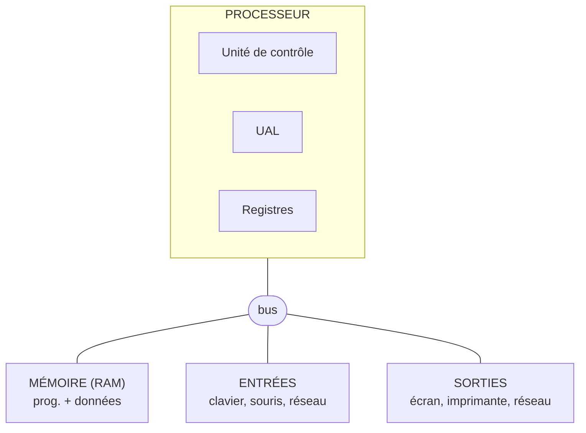

## L'idée

Ordinateur portable, PC de bureau, smartphone ou serveur d'un datacenter : tous suivent le même schéma, imaginé en 1945 par le mathématicien John von Neumann. Un **processeur** exécute des instructions, une **mémoire** contient à la fois les programmes et les données, et des **périphériques d'entrée et de sortie** échangent avec le monde extérieur.

Comprendre ce schéma, c'est savoir lire une fiche technique, choisir un ordinateur, et diagnostiquer une panne.

## L'architecture de von Neumann



*Figure : l'architecture de von Neumann. Le processeur (unité de contrôle, UAL, registres) est relié par le bus à la mémoire, aux entrées et aux sorties.*

- L'**unité de contrôle** lit l'instruction suivante et la décode.
- L'**unité arithmétique et logique** (UAL) fait les calculs : additions, comparaisons, opérations logiques.
- Les **registres** sont de toutes petites mémoires internes au processeur, ultra-rapides.
- Le **bus** est le réseau de connexions qui transporte données et adresses.

Le processeur répète sans cesse le même **cycle** : **chercher** l'instruction en mémoire, la **décoder**, l'**exécuter**, puis passer à la suivante. En anglais : *fetch, decode, execute*.

## Le processeur (CPU)

Ses caractéristiques principales :

| Caractéristique | Signification | Exemple |
|---|---|---|
| **Fréquence** | Nombre de cycles par seconde | 3,5 GHz = 3,5 milliards de cycles par seconde |
| **Cœurs** | Processeurs indépendants dans la même puce | 8 cœurs exécutent 8 tâches en parallèle |
| **Threads** | Tâches gérées en même temps (souvent 2 par cœur) | 8 cœurs, 16 threads |
| **Cache** | Mémoire rapide intégrée (L1, L2, L3) | 16 Mo de cache L3 |
| **Architecture** | Jeu d'instructions | x86-64 (Intel, AMD) ou ARM (smartphones, Mac récents) |

La fréquence seule ne suffit pas à comparer deux processeurs : un modèle récent fait plus de travail par cycle qu'un ancien. On compare plutôt des **tests de performance** (*benchmarks*) indépendants.

Le processeur chauffe : il est surmonté d'un **dissipateur** et d'un **ventilateur**, avec une fine couche de **pâte thermique** entre les deux.

## La mémoire vive (RAM)

La **RAM** (*Random Access Memory*) contient les programmes en cours d'exécution et leurs données. Elle est **rapide** mais **volatile** : tout est perdu à l'extinction.

- Capacité courante : 8 Go pour la bureautique, 16 Go pour développer, 32 Go et plus pour la virtualisation ou le montage vidéo.
- Générations : DDR4, puis DDR5. Elles ne sont **pas compatibles** entre elles : la carte mère impose le type.
- Formats : barrettes **DIMM** pour les PC de bureau, **SO-DIMM**, plus petites, pour les portables.

Quand la RAM est pleine, le système déplace des données vers le disque (fichier d'échange) : l'ordinateur ralentit fortement.

## Le stockage

Le stockage conserve les données **sans courant** : on dit qu'il est **non volatile**.

| Type | Principe | Vitesse typique | Remarques |
|---|---|---|---|
| **Disque dur (HDD)** | Plateaux magnétiques en rotation et tête de lecture | 100 à 200 Mo/s | Grande capacité, bon marché, fragile aux chocs |
| **SSD SATA** | Mémoire flash, sans pièce mobile | environ 550 Mo/s | Bon compromis |
| **SSD NVMe (M.2)** | Mémoire flash reliée en PCIe | 3 000 à 7 000 Mo/s et plus | Le plus rapide |

L'écart réel est encore plus grand pour les **petits accès aléatoires**, ceux du démarrage du système : un SSD y est des centaines de fois plus rapide qu'un disque dur.

## La hiérarchie des mémoires

| Niveau | Taille typique | Temps d'accès approximatif |
|---|---|---|
| Registres | quelques centaines d'octets | moins d'une nanoseconde |
| Cache L1, L2, L3 | de quelques Ko à quelques dizaines de Mo | de 1 à 10 ns environ |
| RAM | de 8 à 64 Go | environ 50 à 100 ns |
| SSD NVMe | de 256 Go à quelques To | de l'ordre de 0,1 ms |
| Disque dur | plusieurs To | environ 5 à 10 ms |

Plus une mémoire est proche du processeur, plus elle est **rapide**, **chère** et **petite**. Le cache garde les données utilisées récemment, car un programme réutilise souvent les mêmes données : c'est le **principe de localité**.

## La carte mère, l'alimentation et les autres composants

- **Carte mère** : le circuit principal sur lequel tout se branche. Elle a un **socket** pour le processeur (compatible avec une seule famille), des emplacements de RAM, des connecteurs **M.2** et **SATA** pour le stockage, des ports **PCIe** pour les cartes d'extension, et le **firmware UEFI** (successeur du BIOS) qui démarre la machine.
- **Alimentation** (PSU) : transforme le courant du secteur en tensions continues (12 V, 5 V, 3,3 V). Sa puissance se mesure en watts. Le label **80 PLUS** indique son rendement.
- **Carte graphique** (GPU) : calcule l'affichage. Elle est soit intégrée au processeur, soit **dédiée** sur une carte PCIe, indispensable pour la 3D, le jeu et l'entraînement des modèles d'intelligence artificielle.
- **Carte réseau** : Ethernet (RJ45) et Wi-Fi, souvent intégrés à la carte mère.
- **Boîtier** : protège les composants et organise la circulation de l'air.

## Les périphériques et les ports

| Port | Usage |
|---|---|
| USB-A, USB-C | Clavier, souris, clé, téléphone. L'USB-C transporte aussi l'image et la charge. |
| HDMI, DisplayPort | Écran, vidéoprojecteur |
| RJ45 | Réseau filaire Ethernet |
| Jack 3,5 mm | Audio |

## Démonstration

On lit la configuration d'un ordinateur sans l'ouvrir :

- **Windows** : Gestionnaire des tâches (Ctrl + Maj + Échap), onglet *Performance* : processeur, mémoire, disque, GPU. Pour plus de détails : `msinfo32`, ou le logiciel gratuit **CPU-Z**.
- **Linux** :

```bash
lscpu                 # processeur : modèle, cœurs, threads, cache
free -h               # mémoire vive totale et utilisée
lsblk                 # disques et partitions
sudo lshw -short      # inventaire complet du matériel
```

Puis on compare deux fiches techniques de portables vendus à Dakar : on repère le processeur, la RAM, le type de stockage, l'écran et l'autonomie.

## Exercice guidé

Pour chacune de ces fiches, indique le rôle de chaque élément et l'usage adapté :

1. *Intel Core i5 (10 cœurs), 16 Go DDR4, SSD NVMe 512 Go, écran 15,6" Full HD.*
2. *Intel Celeron (2 cœurs), 4 Go, eMMC 64 Go, écran 14".*
3. *AMD Ryzen 7 (8 cœurs, 16 threads), 32 Go DDR5, SSD NVMe 1 To, carte graphique dédiée 8 Go.*

## Exercice autonome

1. Un étudiant en génie logiciel veut faire tourner Docker, VS Code, un navigateur et une machine virtuelle Linux. Propose une configuration minimale et justifie chaque choix.
2. Le PC d'un cybercafé met 4 minutes à démarrer. Il a un disque dur de 500 Go et 4 Go de RAM. Quelles deux améliorations proposes-tu, dans quel ordre, et pourquoi ?
3. Sur ton propre ordinateur, relève : le modèle de processeur, le nombre de cœurs et de threads, la RAM, et le type de stockage.

## Correction

Exercice guidé :

1. Une machine polyvalente, adaptée aux études d'informatique : 16 Go permettent plusieurs logiciels lourds en même temps, et le SSD NVMe assure un démarrage rapide.
2. Une machine d'entrée de gamme, limitée à la bureautique légère et au web. 4 Go et 64 Go de stockage eMMC (de la mémoire flash lente) seront vite saturés par les mises à jour.
3. Une station de travail : développement, virtualisation, montage vidéo, jeu, ou apprentissage de l'IA grâce à la carte graphique dédiée.

Exercice autonome :

1. Au minimum 16 Go de RAM, car Docker et la machine virtuelle en consomment beaucoup ; un SSD de 512 Go ; un processeur d'au moins 4 cœurs et 8 threads, avec la **virtualisation** activée dans l'UEFI (VT-x ou AMD-V).
2. D'abord **remplacer le disque dur par un SSD** : c'est le goulet d'étranglement du démarrage, et le gain est spectaculaire pour un coût faible. Ensuite, passer à **8 Go de RAM**, si la carte mère l'accepte, pour éviter l'usage du fichier d'échange.

## Pour aller plus loin

- Le simulateur « IT Essentials Virtual Desktop » de Cisco NetAcad permet de monter un PC virtuellement.
- Ce cours prépare au badge Cisco **Computer Hardware Basics**, et au domaine « Hardware » de la certification **CompTIA A+**.
- Cours suivant : « Monter un PC et diagnostiquer le démarrage ».
